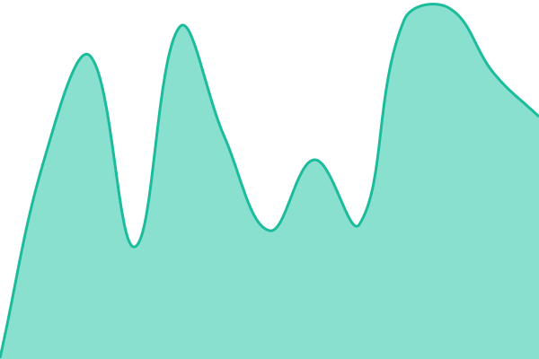

# Attesteo service status

Public status page for Attesteo, powered by [Upptime](https://upptime.js.org): GitHub Actions run the checks, GitHub Issues hold the incidents, GitHub Pages serves the page.

Live page: https://attesteo-ab.github.io/status (moves to https://status.attesteo.com once the DNS record exists).

## How it is run

- Components are the `sites` entries in `.upptimerc.yml`. Add one per production endpoint as it goes live; keep secrets out of the file and reference them as `$NAME` from repository secrets.
- The workflows need a fine-grained personal access token saved as the repository secret `GH_PAT` (Actions, Contents, Issues, Workflows: read and write, scoped to this repository). It is personal: note here who created it, and rotate it if that person leaves.
- Downtime opens an issue automatically and closes it on recovery. Manual incidents and scheduled maintenance are issues too; see the [Upptime docs](https://upptime.js.org/docs/scheduled-maintenance).
- Checks come from GitHub-hosted runners. GitHub's cron is best effort, so intervals are often longer than five minutes.

Token holder: steniss (fine-grained PAT `upptime-attesteo-status`, scoped to this repository).

<!--start: status pages-->
<!-- This summary is generated by Upptime (https://github.com/upptime/upptime) -->
<!-- Do not edit this manually, your changes will be overwritten -->
<!-- prettier-ignore -->
| URL | Status | History | Response Time | Uptime |
| --- | ------ | ------- | ------------- | ------ |
|  [Website (attesteo.com)](https://attesteo.com) | 🟩 Up | [website-attesteo-com.yml](https://github.com/attesteo-ab/status/commits/HEAD/history/website-attesteo-com.yml) | 

 321ms
     
 | 

<a href="https://attesteo-ab.github.io/status/history/website-attesteo-com">100.00%</a>
    

|  [BankID (external)](https://status.bankid.com/api/v2/status.json) | 🟩 Up | [bank-id-external.yml](https://github.com/attesteo-ab/status/commits/HEAD/history/bank-id-external.yml) | 

 269ms
     
 | 

<a href="https://attesteo-ab.github.io/status/history/bank-id-external">100.00%</a>
    

<!--end: status pages-->
